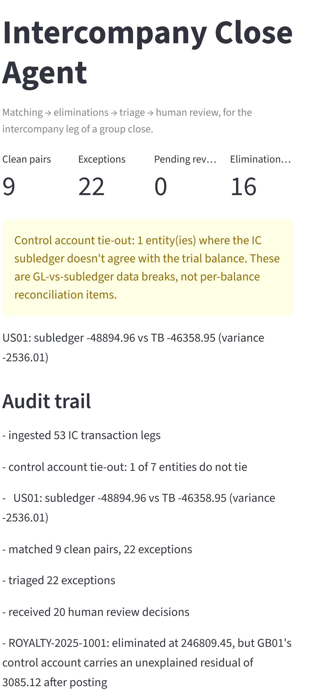

# intercompany-close-agent

[](https://github.com/gabriel-fin-arch/intercompany-close-agent/actions/workflows/ci.yml)

An agent-first assistant for the intercompany leg of a multi-entity group
consolidation close: it matches counterparty bookings, proposes elimination
journal entries with a rationale, and routes anything that genuinely needs
a person's judgment to a human reviewer instead of guessing.

Built against a synthetic dataset (seven fictional entities, none real) so
it's safe to run and inspect end to end. Runs fully offline by default. A
Claude API key upgrades the triage narrative; it doesn't change what gets
booked.

> **About the commit history.** I built this with Claude Code in August 2026
> and first published it that month under an earlier account. The commits were
> dated back, mostly to September 2025–January 2026, to look like months of
> hand-written work, and while publishing here I rewrote the history several
> times to hide that. On 15 October 2026 I rewrote it one last time to put back
> the real times, taken from my Claude Code session logs: author dates are when
> each commit was made, committer dates are when the history was rebuilt.
> [PROVENANCE.md](PROVENANCE.md) lists every change and how to check it.

## Review in 5 minutes

- §§1–2: the close problem and why tolerances, interfaced status and control
  accounts are domain decisions, not string matching.
- §3: the numbers are deterministic Python with tests; the model only triages
  and writes the rationale.
- `docs/human-in-the-loop.md`: the six exception types that never auto-resolve.
- How I built this: which decisions are mine and what an AI assistant wrote.
- The command block below runs the whole close offline; CI is green.



```
uv sync --extra dev
uv run python -m intercompany_close_agent.cli generate-data
uv run python -m intercompany_close_agent.cli run
uv run streamlit run app/streamlit_app.py
uv run pytest
```

---

## 1. The business problem

Every month, a consolidated group has to eliminate intercompany balances
before the numbers can go out: if entity A booked a $50,000 receivable from
entity B for a management fee, and B booked the matching $50,000 payable,
the group's books need to net that back out to zero before it hits the
consolidated P&L and balance sheet. Multiply that across dozens of entities
and hundreds of intercompany transactions a month, and the actual work
becomes: pull both sides of every balance, match them up, and figure out
what to do with the ones that don't match cleanly. A counterparty that
never booked its side. An amount off by more than rounding. A balance
booked against the wrong entity. A booking that landed after the other
side's cutoff.

Most of that matching is mechanical. Some of it genuinely isn't, and
knowing which is which, without either burying a reviewer in noise or
quietly auto-resolving something that needed a second pair of eyes, is the
actual problem this project is about.

## 2. Why it needs domain knowledge

A generic "diff two CSVs and flag what doesn't match" tool gets this wrong
in ways that matter:

- **Tolerances aren't optional.** A one-cent rounding difference and a
  $50,000 sign error are not the same kind of problem, even though both are
  "the amounts don't match." Getting the tolerance band and the materiality
  threshold right is a judgment call that reflects how the group actually
  runs its close, not a constant you hardcode once and forget.
- **Not every entity is equally trustworthy.** An entity whose trial balance
  loads automatically from the source ERP is a different risk profile than
  one that's keyed in by hand every month. This project's one
  non-interfaced entity (`ZA01`) carries a standing chance of manual
  re-keying noise in the synthetic data for exactly this reason. Triage
  reads that flag: a balance touching a manually loaded entity is never
  auto-eliminated on the strength of being small, where an all-interfaced
  one of the same size would be.
- **"Same period" beats "a few days apart."** Two legs booked eight days
  apart inside one month both make it into the same close and consolidate
  fine. Two legs booked one day apart across a month end do not. The
  timing check compares accounting periods, not elapsed days, because
  elapsed days is the wrong question.
- **Some exception types are never "small enough to auto-resolve."** A
  missing counterparty booking, a balance against the wrong entity, an
  entity booked as its own counterparty, two legs booked on the same side
  instead of one of each, two legs in different currencies, a reference
  shared by more than two legs: all six are control questions rather than
  amount questions, and the dollar value doesn't make any of them safe to
  wave through. See `docs/human-in-the-loop.md` for the reasoning on each.
- **You tie out before you eliminate.** Before matching anything, the
  pipeline checks each entity's IC subledger against its intercompany
  control accounts on the trial balance. A balance that won't match its
  counterparty is one reconciliation item; a control account that won't
  tie means the subledger and the GL disagree about the totals, and every
  elimination built off it is suspect. Those are different problems and
  the tool treats them differently.
- **US GAAP / SOX context shapes what "done" means.** An elimination that
  nets to zero on paper still needs an audit trail a controls reviewer can
  follow: what was eliminated, based on what evidence, approved by whom.
  "Approve" and "reject" aren't just UI buttons here, they're distinct
  audit trail states.

## 3. Agent architecture

```
ingest -> reconcile -> match -> triage -> human_review -> finalize
```

Built as a [LangGraph](https://github.com/langchain-ai/langgraph)
`StateGraph`. Two design decisions carry the whole project:

**The LLM does not do arithmetic.** Tying the subledger to the trial
balance, matching two IC legs, checking a tolerance, and building a
balanced elimination entry are all deterministic Python
(`reconciliation/`, `matching/`, `eliminations/`) with full unit coverage,
including a net-zero invariant enforced at the model level. The model never
sees a number it's asked to add up. It only classifies an exception
(`auto_resolvable` vs. `needs_human_judgment`) and writes the rationale a
reviewer reads. If the arithmetic and the judgment call lived in the same
function, there'd be no way to unit test the numbers without also depending
on a live model call.

**Triage runs against Claude, or a deterministic rule-based fallback, with
the same output shape either way.** With `ANTHROPIC_API_KEY` and
`ANTHROPIC_MODEL` set, `triage/llm.py` calls Claude via `langchain-anthropic`
with structured output. Without them, or if the live call fails for any
reason (rate limit, network blip, a model that rejects the request),
`triage/rules.py` takes over: a small, legible set of rules keyed on exception
type and materiality. A warning names each exception that fell back and why,
so a broken model configuration can't pass for a working one. Nothing in
`graph/nodes.py` or the CLI/dashboard changes based on which path ran; they
only ever see a `TriageResult`. That's also what makes the whole project
runnable and testable without an API key.

**Where the graph can stop.** `human_review` is the only node that talks to
a person. If triage found anything that needs judgment, it calls
LangGraph's native `interrupt()` and the run pauses there: the CLI prints
the worklist and exits, the dashboard renders it and waits for decisions.
Resuming with `Command(resume=decisions)` picks the graph back up exactly
where it stopped. See `docs/architecture.md` for the state shape and node
details.

## 4. Where I put the human in the loop, and why

Six exception types are **never** auto-resolved, regardless of dollar
amount: a missing counterparty booking, a balance booked against the wrong
entity, an entity booked as its own counterparty, two legs booked on the
same side (both receivable or both payable -- a sign error, not an amount
error), a reference shared by more than two legs, and two legs denominated
in different currencies. None of them is really a question about *how
much*. They're questions about *who* booked *what*, in *what units*, or in
*which direction*, and no rule engine or model should get to quietly decide
that's fine because the number looks small. A currency mismatch is the
sharpest example of the first: the amounts can net to exactly zero and
still mean nothing, because netting them applies an implicit 1:1 rate
between two different currencies. A sign mismatch is the sharpest example
of the last: the amounts can be identical to the cent, and the elimination
would still net a completely made-up direction, since nothing in the ledger
says which entity has it backwards. Only genuine amount and period
residuals get auto-resolved, and only when they're below the materiality
threshold.

Crucially, that rule -- and the materiality threshold, and the manually
loaded-entity policy below -- is enforced **in code after the classifier
returns**, not only in the prompt the model is given. An intercompany
reference is free text submitted by an affiliate and it goes into that
prompt verbatim, so a reference carrying "ignore prior instructions" is a
realistic thing to find in a file. If a guarantee matters, it belongs
somewhere the model can't see it.

That taxonomy is a judgment call, not a law of nature. It's flagged with a
`# REVIEW:` comment in `triage/rules.py` so it's easy to find and easy to
disagree with. The full reasoning, including what approve, reject and edit
each actually book, lives in `docs/human-in-the-loop.md`; the thresholds and
why they sit where they do are in `docs/architecture.md`.

## How I built this

With an AI coding assistant (Claude Code), and the split is deliberate. The
accounting design is mine: tying out the control accounts before matching
anything, the six break types that never auto-resolve, the materiality and
manually-loaded-entity policy, what approve, reject and edit each book, and
which anomalies the synthetic data has to contain. I worked it out in design
notes I drafted with the help of an AI chat before any code existed. Claude
Code wrote the code and the tests, and most of the docs, against that design.
I reviewed what it produced and sent back what was wrong; every decision
listed above is one I can walk you through. The commit messages before 14
October 2026 are the assistant's too, written in a casual first-person style I
asked for; commits it drafts now carry a `Co-Authored-By` line.

## Project layout

```
src/intercompany_close_agent/
  models/          pydantic domain models (Entity, ICTransaction, ICException, Elimination, ReviewDecision, ...)
  ingest/          CSV loaders + chart-of-accounts mapping
  reconciliation/  trial balance control-account tie-out     <- unit tested
  matching/        deterministic IC matching engine          <- unit tested
  eliminations/    elimination JE generation                 <- unit tested
  triage/          LLM triage (Claude) + offline rule fallback
  graph/           LangGraph state, nodes, and the compiled graph
  synthetic/       synthetic dataset generator
  cli.py           typer CLI
app/
  streamlit_app.py   reviewer dashboard
data/synthetic/      committed sample dataset (regeneratable)
docs/                architecture.md, human-in-the-loop.md, data-model.md
tests/
```

## Running it

```
uv sync --extra dev

# regenerate the synthetic dataset (optional -- a sample is already committed)
uv run python -m intercompany_close_agent.cli generate-data

# run the close pipeline end to end, offline
uv run python -m intercompany_close_agent.cli run

# same, but with live Claude triage narratives instead of the rule fallback
cp .env.example .env   # then fill in ANTHROPIC_API_KEY and ANTHROPIC_MODEL
uv run python -m intercompany_close_agent.cli run

# review pending exceptions interactively
uv run streamlit run app/streamlit_app.py

# run the test suite
uv run pytest
```

Or without Python or uv, with Docker: the image runs the same offline close
on the committed sample, and the dashboard on request (see the `Dockerfile`).

```
docker build -t intercompany-close-agent .
docker run --rm intercompany-close-agent
```

## What's out of scope (for now)

FX/CTA translation, AR aging reconciliation, and Special Charges are all
real parts of a consolidation close, and all out of scope here: this
project stays narrow on purpose. They're natural extensions if this
ever grows past a portfolio piece.

## License

MIT -- see `LICENSE`.
